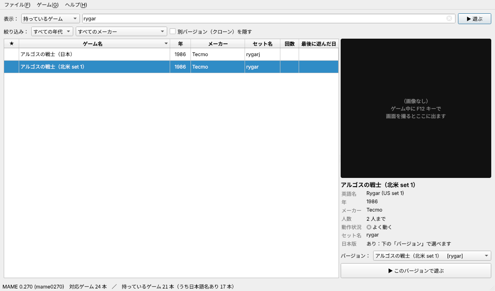

# アーケード棚（Arcade Tana）

**MAME を日本語で使いやすくするランチャー**です（Ubuntu 用）。
MAME 本体には手を加えず、外から `mame` コマンドを呼び出して使います。



## できること
- 持っている ROM だけを一覧表示（ROM フォルダの zip / 7z を自動で探す）。ダブルクリック／Enter で起動
- **日本語名で表示・検索**：有名なゲーム約280本は最初から日本語名。別バージョンにも自動で付く
  - 自分でも名前と読みを付けられる（F2）
  - あいうえお順に並ぶ。ひらがな・カタカナ・全角半角の違いを気にせず検索できる
- **日本版・海外版が分かる**：「アルゴスの戦士（日本）」「アルゴスの戦士（北米 set 1）」のように地域を表示。
  右下の「バージョン」で選んで起動できる
- **マージ形式の ROM セットに対応**：rygar.zip の中に日本版 rygarj も入っている形式でも、日本版を遊べると判定
- 年代・メーカーで絞り込み、別バージョン（クローン）をまとめて隠す（日本版を優先して残す）
- ゲーム画面の画像と、年・メーカー・人数・動作状況を表示（ゲーム中に F12 で撮った画面が自動で出る）
- お気に入り、遊んだ回数、最後に遊んだ日
- 起動に失敗したとき、原因を日本語で説明
- **ゲームパッドで操作**（pygame が必要）。F11 で全画面表示

## インストール（Ubuntu 25.04 以降）
[Releases](https://github.com/kenjiiida-commits/ArcadeTana/releases) から `arcade-tana_<版>_all.deb` をダウンロードして：
```
sudo apt install mame
sudo apt install ./arcade-tana_0.7.0_all.deb
```
PySide6・pygame は Ubuntu 公式パッケージが自動で入ります。アプリ一覧の「アーケード棚」から起動します。

### DEB を使わない場合
```
sudo apt install mame python3-pyside6.qtwidgets python3-pygame
python3 arcade_tana.py      # そのまま起動
./install.sh                # このユーザーだけにインストール
```

### DEB を自分で作る場合
```
./build_deb.sh              # dist/ に .deb ができる
```

## はじめに
1. 「ファイル → 設定」で **ROM フォルダ** を追加する（`~/.mame/mame.ini` に rompath があれば自動で読み込み）
2. 初回だけ、年・メーカーの情報を MAME から読み込む（数十秒）
3. 一覧から選んで遊ぶ

## ゲームパッドの操作
| ボタン | 動き |
|---|---|
| 十字キー・左スティック 上下 | ゲームを選ぶ（押しっぱなしで連続移動） |
| 左右・LB / RB | 10 本ずつ移動 |
| A・START | 遊ぶ |
| Y | お気に入りに追加／外す |
| X | 表示の切り替え（持っている／お気に入り／最近／すべて） |
| BACK（SELECT） | 別バージョンを隠す の切り替え |
| B | 検索をクリア |

ゲーム中は、アーケード棚はパッドに反応しません。

## 日本語名リスト
同梱の `jp_names.tsv` は「セット名<TAB>日本語名<TAB>読み」の形式です（読みは漢字で始まる名前だけ）。
誤りや追加の提案は Issue・Pull Request で歓迎します。
自分で付けた名前は「ファイル → 日本語名リストを書き出す」で TSV に保存・共有できます。

## 保存場所
- 設定・日本語名・お気に入り：`~/.config/arcade-tana/config.json`
- ゲーム一覧・詳細情報のキャッシュ：`~/.cache/arcade-tana/`

## ご注意
- このソフトに ROM は含まれていません。ROM は権利者の許可を得たものを使ってください。
- MAME® は Gregory Ember 氏の登録商標です。本ソフトは MAME 開発チームとは関係ありません。

## ライセンス
MIT License（作者：飯田顕治）
